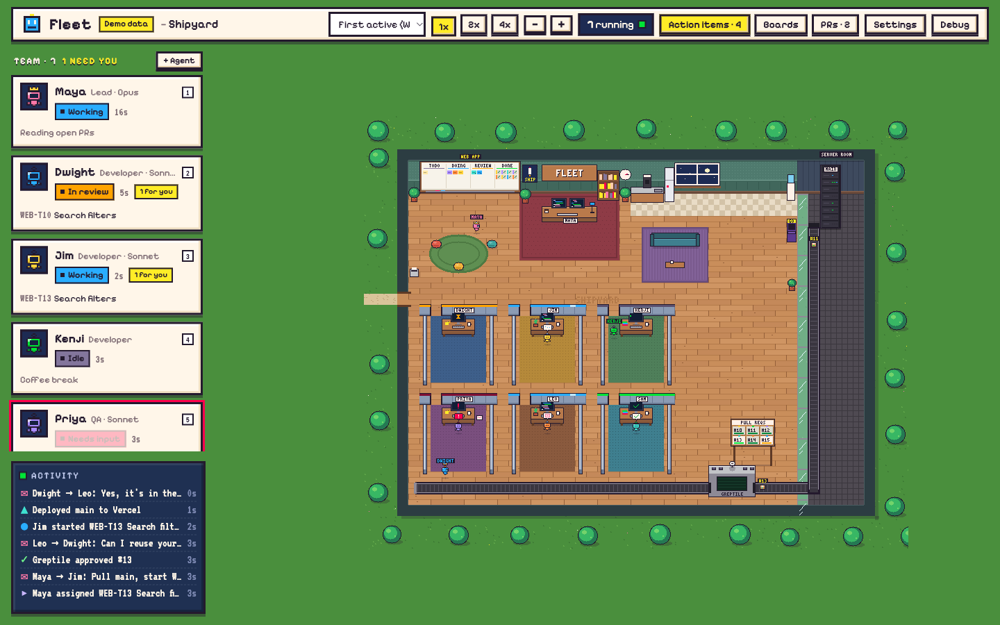
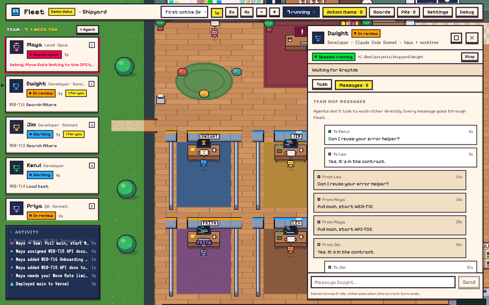
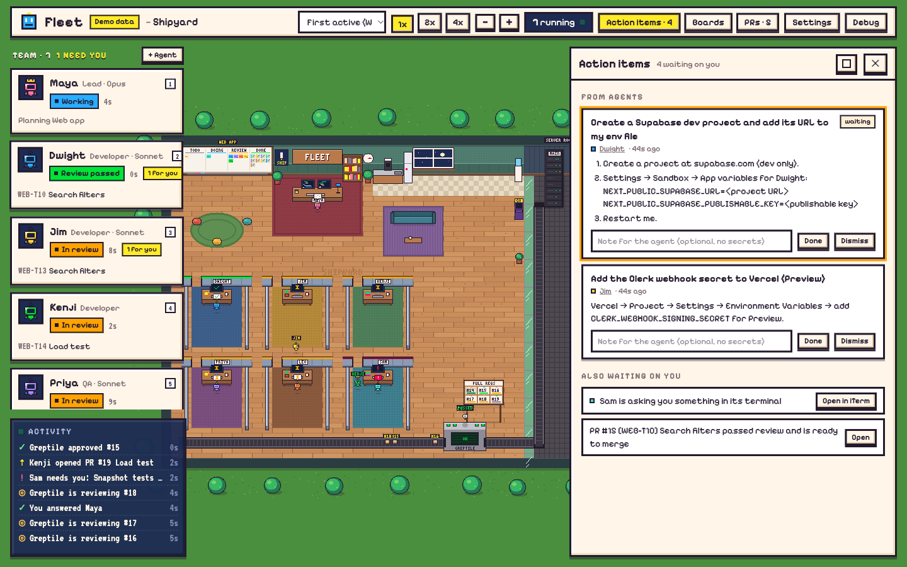
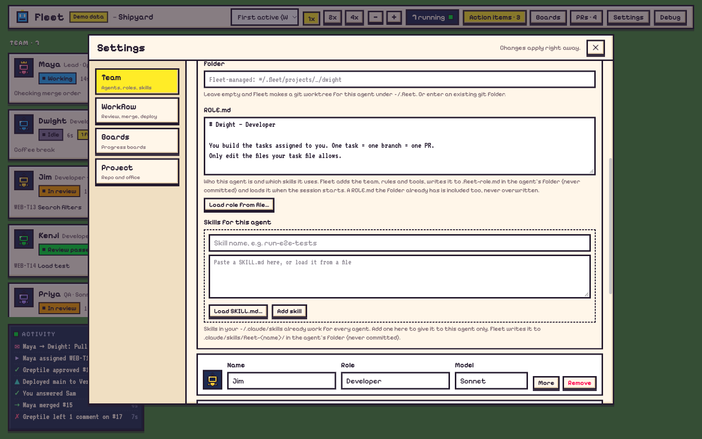

# Fleet

https://github.com/user-attachments/assets/fa72b826-72be-4002-bd1d-0c431a469238

A pixel-art office for a team of Claude Code agents on macOS, Linux or Windows (through WSL). You talk to one agent, the
CTO. It plans the work, hands tasks to the rest of the team, and you watch all of it happen.

**[fleet.jainildesai.com](https://fleet.jainildesai.com)**: overview, docs and changelog.



Fleet's office UI and much of its agent-team server come from
**[JSM HQ](https://github.com/jsmastery-pro/jsm-hq)** by JavaScript Mastery (MIT). Fleet
takes HQ's office and team model and runs it without Docker or a browser terminal: every
agent is a real Claude Code session in `tmux`, working in its own git worktree, and every
decision or permission it needs from you lands in one Actions list.

- **Visibility first.** Each agent sits at a desk and shows what it's doing now: working,
  waiting on you, or done. Tasks move across the plan wall, messages fly between desks, and
  every reply is readable Markdown.
- **One person to talk to.** You message the CTO. It breaks the request into tasks and assigns
  them to the Planner, Implementer, QA, Reviewer and Deployer, starting each agent only when
  it's first needed.
- **You decide.** Plan approvals, questions and Claude Code permission prompts (Allow/Deny)
  all show up in Actions. Fleet never approves anything on its own, but agents follow your
  Claude Code permission mode: in auto mode, for example, edits run without asking.
- **Real sessions.** Agents run `claude` in tmux. **Open in terminal** attaches to any of them
  (iTerm or Terminal.app on macOS, your terminal on Linux, Windows Terminal on WSL), and they
  keep running if you close Fleet.
- **No runtime dependencies.** The UI and server are prebuilt into the package.

## Install

Needs Node 20 or later, Claude Code (`claude`) signed in, and tmux, on macOS, Linux, or
Windows through WSL. The GitHub CLI (`gh`, signed in) is optional; with it, Fleet follows the
team's pull requests and reviews.

### macOS

```bash
brew install tmux          # and optionally: brew install gh
npm install -g @jainil_desai/fleet
cd ~/code/my-app           # any git repo
fleet                      # opens this repo's Fleet, http://localhost:7789
fleet home                 # the home page, http://localhost:7788 (fleet outside a repo does the same)
```

### Linux

```bash
sudo apt install tmux      # Fedora: sudo dnf install tmux; Arch: sudo pacman -S tmux
npm install -g @jainil_desai/fleet
cd ~/code/my-app
fleet                      # opens http://localhost:7789 with xdg-open
```

Install Claude Code with `curl -fsSL https://claude.ai/install.sh | bash` and run `claude` once
to sign in. `gh` is optional: [its Linux install page](https://github.com/cli/cli/blob/trunk/docs/install_linux.md)
covers apt, dnf, pacman and the rest.

### Windows (via WSL)

Fleet doesn't run on Windows itself (agents run in tmux); it runs inside WSL, and you use it
from your Windows browser. Running `fleet` in PowerShell or cmd just prints these steps.

1. In PowerShell: `wsl --install`, restart, and open **Ubuntu** from the Start menu.
2. Inside Ubuntu, install Node 20 or later, with [nvm](https://github.com/nvm-sh/nvm)
   (`nvm install 22`) or [NodeSource](https://github.com/nodesource/distributions).
3. `sudo apt update && sudo apt install tmux git`
4. Claude Code: `curl -fsSL https://claude.ai/install.sh | bash`, then run `claude` once and
   sign in.
5. Optional: `gh`, from [its Linux install page](https://github.com/cli/cli/blob/trunk/docs/install_linux.md),
   then `gh auth login`.
6. `npm install -g @jainil_desai/fleet`
7. Keep your repo in the Linux file system (for example `~/code/my-app`), not under `/mnt/c`:
   git and agents are many times faster there, and file watching works. Then `cd ~/code/my-app`
   and run `fleet`.
8. Open http://localhost:7789 in your Windows browser (Fleet tries to open it for you, with
   `wslview` or `explorer.exe`).

Fleet works on one git repo per run (with at least one commit): the folder you start it in,
or `--repo <path>`. Other options: `--port 8000`, `--no-open`, `--list`, `--version`. To try it without
installing: `npx @jainil_desai/fleet --repo ~/code/my-app`.

Fleet checks what it needs when it starts (tmux, Claude Code and its sign-in, `gh`, a GitHub
remote, and which terminal it opens) and shows the result, with a command to fix each
missing one, on the welcome screen and in **Settings → Project**.

If `npm install` fails with `ETARGET` right after a release, npm's cache hasn't seen the new
version yet: `npm i -g @jainil_desai/fleet@latest --prefer-online`.

**Optional (macOS):** `brew install terminal-notifier` makes notification banners clickable.

**Terminal.** **Open in terminal** attaches a terminal window to the agent's tmux session.
When Fleet can't open one, it shows the `tmux attach` command to run yourself, with a Copy
button.

- **macOS:** iTerm when it's installed, Terminal.app otherwise; iTerm is optional. The first
  time, macOS asks whether Fleet (your terminal or Node) may control iTerm or Terminal. Allow
  it once. If it was denied, allow it later in System Settings → Privacy & Security → Automation.
- **Linux:** the first of `x-terminal-emulator`, `gnome-terminal`, `konsole`, `xfce4-terminal`,
  `kitty`, `alacritty`, `wezterm` and `xterm` that's installed. It needs a desktop session
  (`DISPLAY` or `WAYLAND_DISPLAY`); over SSH or from a background service, copy the command.
- **WSL:** a new Windows Terminal tab (`wt.exe`) in your distro, else a Linux terminal through
  WSLg, else the command to copy.

The setup checks show which one Fleet will use.

From source: `git clone https://github.com/jainilDesai/fleet.git && cd fleet && npm install && npm run build && node bin/fleet.js --repo <path>`.

### Start at login

```bash
fleet --autostart          # start Fleet at login for this repo, in the background, and start it now
fleet --stop               # stop this repo's Fleet for now; it starts again at the next login
fleet --start              # start this repo's background copy again now
fleet --no-autostart       # turn auto-start off for this repo and stop its background copy
```

Fleet then runs without opening a browser tab (the [home page](#home-page) links to it),
restarts if it crashes, and logs to `~/.fleet/fleet-<project>.log`. Each repo gets its
own login item with its own fixed port: the one you pass with `--port`, else the one it had, else the first
free port from 7789. The first `fleet --autostart` also sets the home page to start at login. Install Fleet globally first (`npm install -g`); `--autostart` refuses to
run from the npx cache, which npm can clear. If you update Node through nvm, or move Fleet, run
`fleet --autostart` again; Fleet reminds you when you start it by hand.

- **macOS:** a standard LaunchAgent, `~/Library/LaunchAgents/com.jainildesai.fleet.<project>.plist`.
- **Linux:** a systemd user service, `~/.config/systemd/user/fleet-<project>.service`
  (`systemctl --user status fleet-<project>`). It starts when you log in; to start it at boot
  without logging in, run `loginctl enable-linger "$USER"` once.
- **WSL:** the same systemd user service, which needs systemd turned on in WSL. If it's off,
  `fleet --autostart` says so: add `[boot]` and `systemd=true` to `/etc/wsl.conf`, run
  `wsl --shutdown` in Windows and open your distro again. Fleet then starts when WSL does
  (when you open the distro), not when Windows starts. Or just run `fleet` in a terminal.

Set up with Fleet 0.3? Your `com.jainildesai.fleet` item still counts as that repo's item:
`--stop`, `--start` and `--no-autostart` find it, and `fleet --autostart` in that repo replaces
it with the per-project one on the same port.

## Home page

`fleet home` (or `fleet open`, or plain `fleet` outside a git repo) opens Fleet's home page at
**http://localhost:7788**, the one address to remember. It runs in the background (a light
server: no repo, no agents, no tmux), starts if it isn't running, and also starts whenever you
run `fleet` in a repo.

- **Header:** how many projects Fleet knows, how many run, and the total cost.
- **A card per project** (every repo Fleet has run in, from `~/.fleet/projects/`): repo path,
  running or stopped, its URL, agents running, how many things need you (its Action items),
  open PRs and its cost. **Open** goes to the project, **Start** starts it in the background
  (its login item if it has one, else `fleet --repo <repo> --no-open`), **Stop** is
  `fleet --stop` for that repo. A project whose repo folder is gone is dimmed, with **Forget**,
  which deletes only Fleet's folder for it after asking; it never touches a repo.
- **Cost** is the API-equivalent cost of the project's agents' sessions (subagents included),
  for today, the last 7 days and all time, from `~/.fleet/history.json`. On a Claude plan you
  don't pay this per session. A session counts on the day it last ran.
- It updates every few seconds. Every project's top bar has a **Home** link back to it.

```bash
fleet home --autostart     # start the home page at login (done for you by the first fleet --autostart)
fleet home --no-autostart  # stop starting it at login, and stop it
```

On macOS its login item is `com.jainildesai.fleet.home`; on Linux and WSL, `fleet-home.service`.
`fleet --stop --all` and `fleet --no-autostart --all` include it. Set `FLEET_HOME_PORT` to move it.

**Upgrading from 0.5 or earlier.** Projects used to start at 7788, so a project's login item may
be pinned there. The first time the home page starts (from `fleet`, `fleet home` or at login),
Fleet moves that login item to the next free port from 7789, restarts it, and says what moved.
Its agents keep running in tmux. Agents started before the move still call 7788 for their hooks
and Team MCP; the home page passes those calls on to their project (matched by the project's
agent token), so they keep working while the home page runs. Agents pick up the new port the
next time they start.

### Install as an app

The home page installs as an app, with its own window, Dock or taskbar icon, and Spotlight entry:

- **Chrome or Edge:** open http://localhost:7788 and click the install icon in the address bar
  (or ⋮ → Cast, save and share → Install page as app).
- **Safari (macOS Sonoma or later):** File → Add to Dock.

Then open it like any app, for example Spotlight → "Fleet". Projects open in your browser
(each runs on its own port).

## Several projects

Run `fleet` in each repo you want a team on. Each copy is its own project: its own team, plan,
port and tmux sessions.

- **Ports.** The first copy gets 7789 (7788 is the home page's). When it's taken and you didn't
  pass `--port` (or `FLEET_PORT`), Fleet takes the next free port and says which. Running `fleet` again in a repo
  that already has one opens that one instead of starting a second.
- **`fleet --list`** prints every running copy with its URL, project and repo.
- **Switcher.** When other copies are running, the top bar shows **⇄ n** next to the project
  name: a list of the other projects, linking to each one.
- **Start at login** works per repo: run `fleet --autostart` in each. `--stop`, `--start` and
  `--no-autostart` act on the repo you run them in (or `--repo`); add `--all` for every repo.
- **Same folder name.** Projects are named after the repo folder. A second repo with a name
  that's taken (say two `app` folders) gets `app-<hash>`, so the two never share a team.
- **Banners and history.** Only one copy at a time watches every Claude session on the machine,
  raises banners and writes `~/.fleet/events.jsonl` and `history.json`; another copy takes over
  when it stops.

**Two teams on one repo.** You can run Fleet on two checkouts of the same git repo (for example
`~/code/app` and a worktree `~/code/app-hotfix`). Agents' worktrees then sit on branches
`fleet/<project>/<agent>`, so the two teams never want the same branch. Limits: both teams use
the same GitHub PR list and number tasks the same way (`B1-T01`…), so a team only takes a PR
when it comes from its own `fleet/<project>/…` branch or the agent reported its number with
`set_my_status`; until then the PR shows in both, unclaimed. Agents' own task branches
(`implementer/…`) look the same in both teams and don't count.

## Stopping

- **One agent:** open it (click its desk or card) and press **Stop** in its drawer.
- **The whole team:** **Stop team** in the top bar (shown while any agent runs) lists who is
  running and asks first. **Stop agents** ends their Claude Code sessions; committed work,
  worktrees, branches, plans and the team stay, and **Start team** brings them back.
- **The team and Fleet:** **Stop agents and quit Fleet** in the same dialog also exits Fleet. The
  page then says Fleet has stopped. Start it again with `fleet` in the repo, or `fleet --start`
  if it starts at login. It exits cleanly, so the login item doesn't restart it before then.
- **From a terminal:** `fleet --stop` stops this repo's Fleet, `fleet --stop --all` every one, and
  Ctrl-C stops a copy you started in a terminal. These leave the agents running in tmux.

## First run

1. **Create team.** The welcome screen shows the requirements check, then the team: a CTO and
   five roles. Without a GitHub remote, PR review starts off and agents work on local branches.
2. **Start team.** Press **Start team** in the top bar. It starts the CTO; the others start
   when the CTO first gives them work.
3. **Trust the folder.** On an agent's first start, Claude Code asks whether you trust its new
   worktree. Press **Trust folder** in Action items (or the agent's drawer), or answer it with
   **Open in terminal**.
4. **Open the CTO.** Click the CTO's card or desk, then the **Messages** tab.
5. **Type a task**, for example "Add a /health endpoint that returns ok", and send it.
6. **Watch Action items.** Plans to approve, questions and permission prompts land there; the
   plan wall and the agents' desks show the rest.

## What you get



**The office.** Every team member is a character at a desk that shows its state: working,
idle, needs you, in review. The top bar shows how many agents are running and how many
things are waiting on you. Click an agent to open its drawer:

- **Task:** what it's working on, the task's notes, and its branch.
- **Messages:** everything between you, the CTO and that agent, rendered as Markdown
  (headings, lists, tables, code). Long replies start collapsed with **Show all**.
- **Open in terminal:** attaches to the agent's tmux session (`tmux attach -t fleet-<repo>-<agent>`),
  so you can read or type into the real Claude Code session.

**The team.** A new project starts with a CTO (the lead) and five roles. Each role has a
short role text you can edit in **Settings → Team**, along with its model and Claude Code
permission mode:

| Role | Does |
| --- | --- |
| CTO | Talks to you, plans the flow, creates and assigns tasks. Never writes app code or deploys. |
| Planner | Turns a request into a plan that follows the repo's own rules. Doesn't change code. |
| Implementer | Builds the approved plan on its branch and commits. |
| QA | Checks out the branch, installs, tests, and reports pass/fail with evidence. |
| Reviewer | Reviews the diff for bugs and simplicity, ranked by severity. |
| Deployer | Deploys only when you asked, and asks you to approve each deploy first. Starts in `default` permission mode. |

The default role texts are generic: they follow your repo's own instructions (`CLAUDE.md`)
and use any skills you have. See [Customise your team](#customise-your-team) to make them
your flow.

**The plan wall.** Boards and tasks the CTO creates, with status (to do, in progress, in
review, done, blocked) and owner. Tasks update themselves as agents report back and as their
pull requests are reviewed and merged.



**Actions.** One list of everything that needs you:

- **Questions and approvals** an agent asked with `ask_user` (for example "Approve plan: …" or
  "Approve deploy to production: …"). Mark a question **Done** or **Dismiss** it; a waiting
  agent continues with your answer. An approval shows **Approve** / **Reject** instead, with an
  optional reason sent to the agent. Reject tells the agent not to do it and not to look for
  another way.
- **Permission prompts.** When Claude Code asks to run a command or edit a file, the request
  shows here with the full command. **Allow** or **Deny** it from the browser, or answer in the
  terminal; either one closes the other. A production deploy is labelled
  `⚠ PRODUCTION deploy: <branch>` so it never looks routine.
- **Agents waiting in their terminal**, with **Open in terminal**. Claude Code's folder-trust
  prompt also has **Trust folder**, which answers "Yes, I trust this folder" (only for
  worktrees Fleet made).

**Pull requests.** With `gh` signed in and a GitHub `origin`, Fleet polls the repo's PRs. It
links each one to its task and agent and reacts: review comments are passed to the author,
a passed review goes to the CTO, and a merge marks the task done. Only PRs from the team's own
branches do this; PRs from forks are ignored. In **Settings → Workflow** you choose the
review tool (CodeRabbit, Greptile, Copilot, a human or a custom check) and whether you or the
CTO merges.

**Notifications.** Fleet still watches every Claude Code session on the machine and sends a
banner when one needs you or finishes a long turn, even with the page closed. On macOS that's
a notification banner (clickable with `terminal-notifier`). On Linux it uses `notify-send`
when it's installed (`sudo apt install libnotify-bin`), without a click action. On WSL there
are no banners; the events still show in Fleet.

## Customise your team



Out of the box every agent is generic. Make it work the way you do in **Settings → Team →
More**, for any agent, the CTO included:

- **Role.** Rewrite what the agent does, or **Load role from file…** to use a Markdown file.
  Fleet adds the team, the rules and the tools around it.
- **Skills.** Paste a `SKILL.md` or **Load SKILL.md…**, give it a name, and **Add skill**.
  Fleet writes it to `.claude/skills/fleet-<name>/SKILL.md` in that agent's folder, where
  Claude Code loads it. It's never committed, and the repo's own skills are never touched.
  A skill without frontmatter gets a `name` and `description` added.

Changes apply the next time the agent starts.

**Skills for every agent.** Skills in `~/.claude/skills` (or the repo's `.claude/skills`)
already work for all agents. Point to them by name in a role, for example
"Test UI changes with the `browser-test` skill."

**Your defaults for every repo.** Save role texts as `~/.fleet/roles/<role>.md`:
`cto.md` for the lead, and `planner.md`, `implementer.md`, `qa.md`, `reviewer.md`,
`deployer.md`, or any role name you use. A new team, or an agent you add, starts from
your file in place of the built-in text. Teams you already have keep their saved text.

For example, a `~/.fleet/roles/qa.md`:

```markdown
You are QA. You test the branch the lead names and report pass/fail with evidence.

- Run `npm ci && npm test`, then test the change in the browser with the `browser-test` skill.
- Only use the staging store; never production.
- Report what you ran, what passed, what failed (exact output), and what you couldn't test.
```

## How it works

- **Agents.** Each one is `claude` running in a tmux session named
  `fleet-<project>-<agent>`, started through your login shell so it has your usual `PATH`. The CTO
  starts with **Start team**; the others start the first time they get a task or a message.
- **Worktrees.** Each agent works in its own git worktree at `~/.fleet/projects/<project>/<agent>`,
  on a branch `fleet/<project>/<agent>` taken from the default branch (worktrees made by Fleet
  0.3 keep their `fleet/<agent>` branch). Your own checkout is never
  touched.
- **Team tools.** Agents talk to Fleet through a small MCP server at
  `http://127.0.0.1:<port>/mcp`: `list_workers`, `get_status`, `list_tasks`, `create_board`,
  `create_task`, `update_task`, `assign_task` (lead only), `get_my_task`, `set_my_status`,
  `ask_user` and `send_message`.
- **Live state.** Claude Code hooks in each worktree post to Fleet when an agent starts a turn,
  uses a tool, needs input or stops. A message for a busy agent is held and handed over when
  its turn ends. Permission prompts reach the Actions list through Claude Code's
  `PermissionRequest` hook, which Fleet holds open until you answer.
- **Files in each worktree** (all excluded from git through the repo's `info/exclude`):
  `.fleet-role.md` (the role text), `.claude/settings.local.json` (the hooks),
  `.claude/fleet-mcp.json` (the MCP connection) and `.claude/skills/fleet-*/` (skills you
  attached). The last two hold the agents' access token,
  so they are written readable by you only.
- **State** lives in `~/.fleet/projects/<project>/` (its `repo-root` file says which repo it's for): team config, plan, action items, the inbox
  and recent message history, so a restart picks up where it left off.

## Privacy

- **Read:** Fleet reads what Claude Code writes under `~/.claude` (session registry and
  transcripts) and the agents' own transcripts to show their replies.
- **Written:** everything Fleet keeps is in `~/.fleet`. In your repo, Fleet adds git worktrees
  and the excluded files listed above; it doesn't change your own checkout or your Claude Code
  settings.
- **Sent anywhere:** Fleet itself only calls GitHub through your `gh` login, to read the
  repo's pull requests. There is no telemetry. Your agents are ordinary Claude Code sessions
  and use your own login.

## Security

Fleet listens on `127.0.0.1` only. Every action from the page (starting agents, sending
messages, answering permissions) needs a per-run token embedded in the page Fleet serves, and
any request whose `Host` header isn't localhost is rejected, which blocks DNS-rebinding
attacks from other websites. Agents reach the hook and MCP endpoints with a separate agent
token. Agents can do whatever their permission mode allows; prompts that need approval wait
for you, and Fleet never approves one on its own.

## Compatibility

The team runs on Claude Code's documented hooks and MCP support. Fleet also reads agents'
transcripts to show their replies, and detects prompts in the tmux pane; neither is a
documented stable format. If an update breaks something, please [open an
issue](https://github.com/jainilDesai/fleet/issues) with your `claude --version`.

## Limits

- macOS and Linux. Native Windows isn't supported: use WSL (see Install).
- Clickable banners are macOS-only; WSL shows no banners.
- One repo per run. To work on two repos, run `fleet` in each (see Several projects).
- Each agent's worktree starts without `node_modules`; QA installs before it tests.
- 0.3.0 replaces the old dashboard pages (Agents, History, Usage, MCP, Plugins) with the
  office. History is still recorded in `~/.fleet/history.json`, but isn't shown in the UI.

## Development

```bash
npm install
npm run build              # hq/ → public/ (the office UI) and dist/hq.mjs (the team server)
npm test                   # node --test
node bin/fleet.js --repo <path> --port 7799 --no-open
npm run dev                # Vite dev server for the UI, proxied to Fleet on 7789
```

The office UI (React, pixi.js) and the team server (TypeScript, MCP SDK) live in `hq/`.
`npm run build` bundles both, so the published package has no runtime dependencies.
`public/` and `dist/` are build output and aren't committed. Issues and pull requests are welcome.

## License

MIT. The office UI and team server are adapted from
[JSM HQ](https://github.com/jsmastery-pro/jsm-hq), © 2026 JavaScript Mastery, MIT; its license
is in [`hq/LICENSE-jsm-hq`](hq/LICENSE-jsm-hq). JSM HQ's name and logo belong to JavaScript
Mastery, and Fleet is not affiliated with or endorsed by them.

Fleet is an independent project, not made by or affiliated with Anthropic. Claude and Claude
Code are trademarks of Anthropic.
