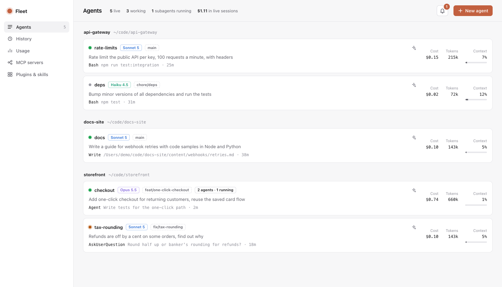
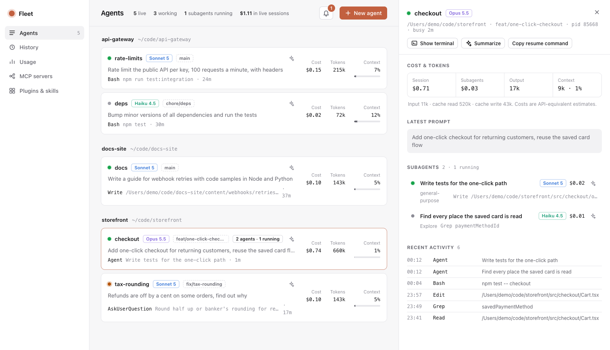
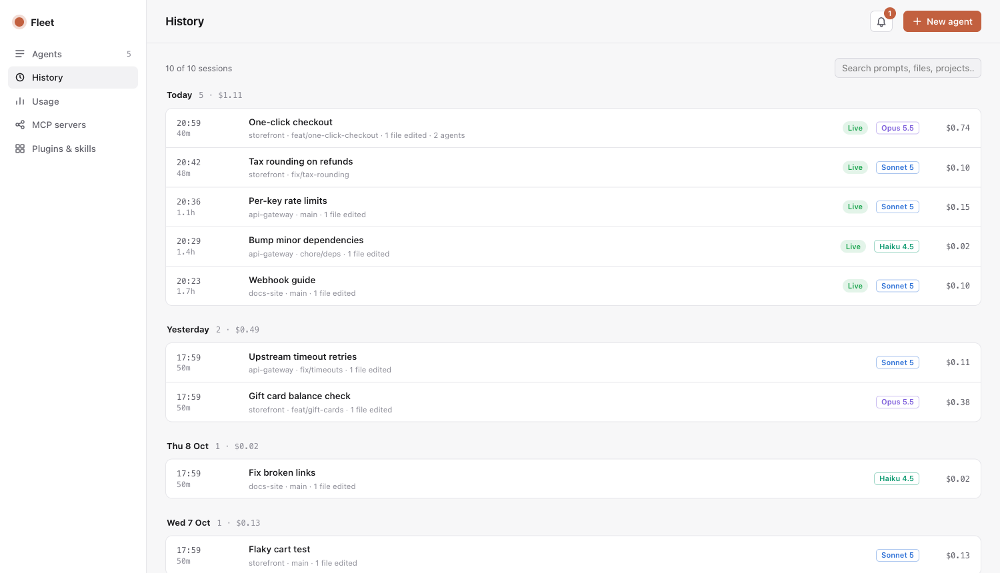

# Fleet

A local dashboard for every Claude Code session on your Mac.

Fleet shows what each agent is doing right now, across every repo, including sessions you
started in an editor's terminal. It tracks what each one costs, the subagents it spawned and
the workflow agents working in phases. You can launch new agents with the right model into
real terminal windows.



It was built to replace one habit: running a single max-model session per task, loading it
with too much context. Fleet makes it cheap to run several small agents instead, each on the
model the task deserves.

- **Zero dependencies.** Node 20+ and the `claude` CLI. Nothing to `npm install`.
- **Read-only by default.** Fleet reads what Claude Code already writes to `~/.claude`. It adds
  no hooks and does not change your settings.
- **Real terminals.** Agents run in Terminal.app or iTerm, not in a browser emulator.

## Install

Needs macOS, Node 20 or later, and Claude Code (`claude`) signed in.

```bash
npm install -g @jainil_desai/fleet
fleet                      # opens http://localhost:7788
```

Options: `--port 8000`, `--no-open`. To try it without installing: `npx @jainil_desai/fleet`.
Install it globally if you want plan limits: the statusline setup below points at Fleet's
install folder, which `npx` doesn't keep.

**Optional:** `brew install terminal-notifier` makes notification banners clickable. A click
opens the exact terminal tab of the session the banner is about.

The first time you launch an agent or click **Show terminal**, macOS asks whether Fleet (your
terminal or Node) may control Terminal/iTerm. Allow it once.

From source: `git clone https://github.com/jainilDesai/fleet.git && cd fleet && node bin/fleet.js`.

## What you get

**Agents.** Every live Claude Code session on the machine, grouped by repo:

- Status (working, idle, or waiting on you), model, git branch, the latest prompt, and the tool call it's running now.
- API-equivalent cost and tokens, including all of its subagents, plus how full its context window is.
- Click a session to see its cost breakdown, the full prompt, a timeline of recent tool calls,
  and a tree of the **subagents** it spawned (nested ones included), with each subagent's model,
  state and cost.
- **Workflows** show as phase columns (for example Foundation → Build → Integrate → Review),
  with every workflow agent's label, state and cost under its phase.
- **Show terminal** brings that session's window forward. For Terminal.app and iTerm it selects
  the exact tab. Sessions inside an editor (Zed, VS Code, Cursor) bring the editor to the front.



**History.** Every session you've run, kept after Claude Code deletes its transcript (Claude
Code removes transcripts older than `cleanupPeriodDays`, 30 by default). Sessions are grouped
by day with their title, project, branch, model, cost including subagents, how long they ran,
the first and last thing you asked, and the files they edited. Search across all of it. A
session can be summarized on demand ("what did it do"), and the summary is kept with it.
Copy a resume command to pick a session back up while its transcript still exists.

On first run Fleet reads every transcript on disk (about 1,000 sessions take ~12 seconds),
then only re-reads transcripts that grew. Records live in `~/.fleet/history.json`; delete
that file to start over. Files edited counts edits made with Claude's Edit and Write tools,
not changes made through shell commands.



**Notifications.** Fleet watches every session and tells you when:

- an agent **needs you**: it asked a question (the question is shown), wants a permission, or
  has a plan ready for review;
- an agent **finished** a turn that took over 20 seconds, so quick replies don't ping you;
- a background subagent is done, a workflow completes, or a workflow agent fails.

These show in the bell's inbox and as a count in the tab title. They also appear as **macOS
notification banners**, even with the dashboard closed, as long as Fleet is running. Turn banners
off in the inbox; subagent completions only go to the inbox. With `terminal-notifier` installed,
clicking a banner opens that session's terminal tab; without it, banners are informational
(macOS gives Fleet's plain banners no way to act on a click). History lives in
`~/.fleet/events.jsonl`. Detection is plain code that diffs session states every 1.5 seconds,
with no hooks and no AI calls.

**Summaries.** Click the ✦ icon on any session card, subagent or workflow agent. You get a two
or three line summary of what it's working on, where it's at, and whether it's waiting on you,
blocked or looping. It's written by Claude Haiku through your own `claude` login. Each summary
takes about 3 seconds and is cached until the agent does more work; outdated ones are flagged.
The summarizer runs with no tools, no MCP servers, no settings files, hooks or plugins, and no
saved transcript, and it never appears on the board. It only runs when you click, so the
dashboard itself stays free.

**New agent.** Pick a repo, a model (Haiku, Sonnet, Opus, Fable), effort, permission mode, an
optional name and first prompt, and optionally its own git worktree. Fleet opens a new terminal
window running that `claude` command through your own login shell (`$SHELL`), so it
gets the same `PATH` and environment as a terminal you open yourself. The command it will run
is previewed before you launch.

**Usage.**

- **Plan limits.** The 5-hour and weekly percentages `/usage` shows, with reset times (see below).
- **Today.** Cost by model and by project, and how much of today's spend went to top-tier models.
- **Last 30 days.** Tokens per day, split by model.
- **All time.** Cost per model.

**MCP servers.** Every server with its health, split into claude.ai account connectors, user
servers, local (per-project) servers and project servers. Scope conflicts are flagged.

**Plugins & skills.** Installed plugins (with what each ships), user and plugin skills, custom
agents, commands and user-level hooks, all searchable.

## Plan limits (the `/usage` numbers)

Claude Code exposes plan-limit percentages to exactly one place: the **statusline** command it
runs after each turn. Fleet ships `bin/statusline.js` for this. It saves the limits to
`~/.fleet/limits.json` and prints a short status line.

Fleet never edits `~/.claude/settings.json` itself. The Usage page shows the exact block to
paste. If you already have a statusline, the block **wraps** it:

```json
"statusLine": {
  "type": "command",
  "command": "/path/to/node /path/to/fleet/bin/statusline.js ~/.claude/scripts/your-bar.sh"
}
```

Your existing script gets the same input, and its output is what your terminal shows, so
nothing changes visually.

## How it works

Everything comes from files and commands Claude Code already provides:

| Data | Source |
| --- | --- |
| Live sessions, busy/idle | `~/.claude/sessions/<pid>.json` (the same registry `claude agents` uses), filtered to live pids |
| Prompts, tool calls, tokens | Session transcripts `~/.claude/projects/<project>/<session>.jsonl`, read incrementally from the last byte offset |
| Subagents | `<session>/subagents/agent-*.jsonl` + `.meta.json` (type, description, parent) |
| Workflows | `<session>/workflows/*.json` (phases, per-agent state) + `<session>/subagents/workflows/<run>/` |
| Daily history | `~/.claude/stats-cache.json` |
| Plan limits | `bin/statusline.js` → `~/.fleet/limits.json` |
| History | Every transcript on disk, distilled into `~/.fleet/history.json` and kept after Claude Code deletes it |
| Summaries (on click) | `claude -p --model haiku` over the tail of the agent's transcript |
| MCP, plugins, account | `claude mcp list`, `claude plugin list --json`, `claude auth status` |
| Skills, agents, commands | `~/.claude/skills`, `~/.claude/agents`, `~/.claude/commands`, plugin install dirs |

**Costs are estimates.** Fleet multiplies token counts by API list prices (see
`src/pricing.js`). A Pro or Max subscription is not billed per token, so read the numbers as
"what this would cost on the API". They're useful for comparing sessions and models, not as a bill.

## Privacy

- **Read:** Fleet reads what Claude Code writes under `~/.claude` (session registry,
  transcripts, settings, stats) and runs `claude mcp list`, `claude plugin list` and
  `claude auth status`.
- **Stored:** everything Fleet keeps is in `~/.fleet`: `history.json` (one record per session,
  including your first and last prompt), `events.jsonl` (the last 200 notifications),
  `limits.json` (plan limits) and `config.json`.
- **Sent anywhere:** only summaries, and only when you click ✦ or "Summarize". Fleet then sends
  the tail of that transcript to Claude Haiku through your own `claude` login, the same account
  and provider your sessions already use. There is no telemetry and no other network call.

## Security

Fleet listens on `127.0.0.1` only. Launching agents and focusing windows start processes, so
those endpoints need a per-run token embedded in the page Fleet serves. They also reject any
request whose `Host` header isn't localhost, which blocks DNS-rebinding attacks from other
websites. The prompt you type is written to a private temp script (mode 700) that deletes
itself, so it never passes through AppleScript string quoting.

## Compatibility

Fleet reads Claude Code's own files, which Claude Code doesn't document as a stable format.
It's tested with Claude Code 2.1.28x. If an update changes the transcript format, the Agents
page says so instead of showing empty numbers; please [open an
issue](https://github.com/jainilDesai/fleet/issues) with your `claude --version`.

## Limits

- macOS only (terminal control uses AppleScript).
- Editor terminals can't be focused to the exact tab; the editor is brought forward instead.
- A running workflow's phase layout appears once Claude Code writes the run file. Until then its
  agents are listed without phases.

## Development

```bash
npm test                   # node --test, against fake transcripts in a temp folder
node bin/fleet.js --port 7799 --no-open
```

No build step and no dependencies. UI files are loaded when the server starts, so restart it
after editing `public/`. Issues and pull requests are welcome.

## License

MIT. Fleet is an independent project, not made by or affiliated with Anthropic. Claude and
Claude Code are trademarks of Anthropic.
